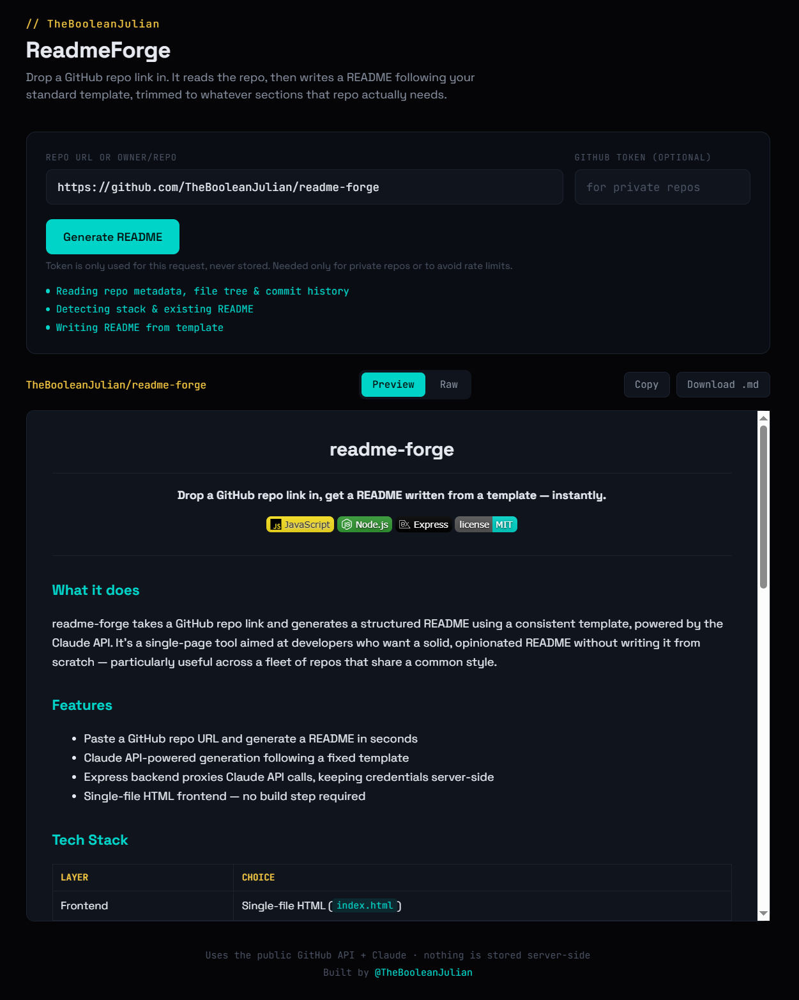

<div align="center">

# readme-forge

**Drop a GitHub repo link in, get a README written from a template — instantly.**


</div>

---



## What it does

readme-forge takes a GitHub repo link and generates a structured README using a consistent template, powered by the Claude API. It's a single-page tool aimed at developers who want a solid, opinionated README without writing it from scratch — particularly useful across a fleet of repos that share a common style. Paste a URL, get a README in seconds.

## Features

- Paste a GitHub repo URL and generate a README in seconds
- Claude API-powered generation following a fixed, opinionated template
- Cloudflare Worker backend with per-visitor rate limiting; model calls go through the fleet LLM gateway, so no API key lives in this repo
- Private repos via your own GitHub token (sent per request, never stored; private repos are never routed to free model tiers)
- Single-file HTML frontend — no build step required
- Hero image path detection and changelog generation built into the template output

## Tech Stack

| Layer | Choice |
|---|---|
| Frontend | Single-file HTML (`public/index.html`) |
| Backend | Cloudflare Worker (`worker.js`), no npm dependencies |
| AI | thebooleanjulian-llm gateway (service binding) |
| Hosting | Cloudflare Workers at readme-forge.thebooleanjulian.dev |

## Screenshots


## Quick Start

```bash
git clone https://github.com/TheBooleanJulian/readme-forge
cd readme-forge
npm test             # node --test, no install needed
npx wrangler dev     # local Worker; /api/generate needs the gateway binding, so test generation on a deploy
```

## Configuration

No secrets. `wrangler.jsonc` binds the `thebooleanjulian-llm` gateway (`LLM`) and a per-IP rate limit
(`GENERATE_LIMIT`, 2 per minute). The gateway decides which model answers (use cases `readme-generate` and
`readme-generate-private`).

## Project Structure

```
readme-forge/
|-- public/index.html   # the page
|-- worker.js           # /api/generate, /healthz, static assets
|-- wrangler.jsonc
`-- test/worker.test.js
```

## Deployment

Cloudflare Workers Builds redeploys on every push to `master` (`npx wrangler deploy`). Branches: feature → dev → master.

## Status / Roadmap

- [x] Single-page UI with repo URL input
- [x] Worker backend calling the fleet LLM gateway (moved off Zeabur, November 2026)
- [x] Rate limiting on `/api/generate`
- [x] Hero image detection in generated output
- [x] Changelog section generated from commit history
- [x] Support for private repos via PAT

## Changelog

- **November 2026** — Moved from Express on Zeabur to a Cloudflare Worker; model calls now go through the thebooleanjulian-llm gateway; private repos use a no-free-tier route
- **July 2026** — Locked down `/api/generate` with server-owned prompt and rate limiting via `express-rate-limit`
- **July 2026** — Added changelog section generated from commit history; added `@TheBooleanJulian` footer credit and real hero image path detection into template output; added hero screenshot and `.env.example`
- **July 2026** — Added Express backend (`server.js`) to proxy Claude API calls server-side
- **July 2026** — Renamed entry point to `index.html` for static hosting compatibility; initial project scaffold

## License

This project is dual licensed.

- Community Edition — [GNU Affero General Public License v3 (AGPLv3)](LICENSE). Free to use, modify, and self-host. If you distribute a modified version or run it as a network service, you must make the corresponding source available.
- Commercial License — for organisations that want to embed, modify, or distribute this software without AGPLv3's obligations. See [COMMERCIAL-LICENSE.md](COMMERCIAL-LICENSE.md).

---

<div align="center">
<sub>Built by <a href="https://github.com/TheBooleanJulian">@TheBooleanJulian</a></sub>
</div>